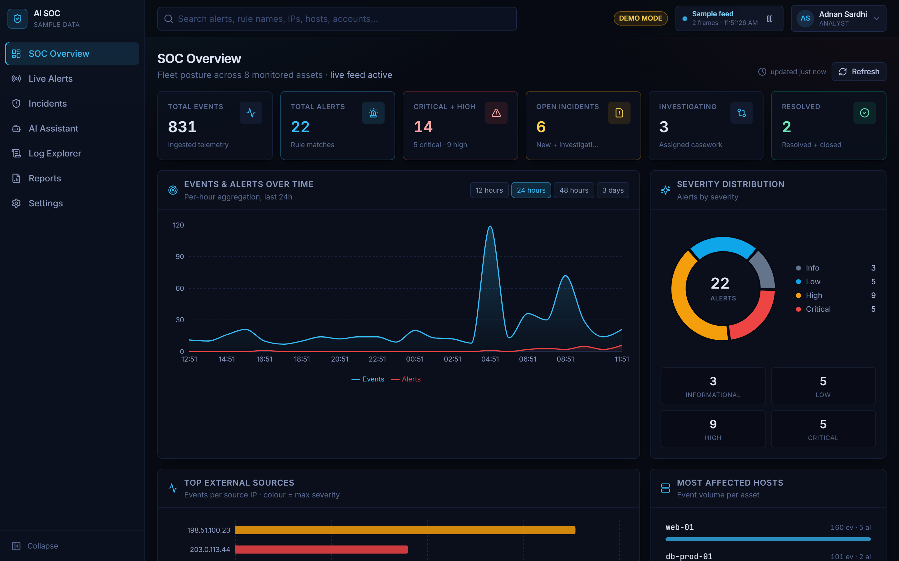
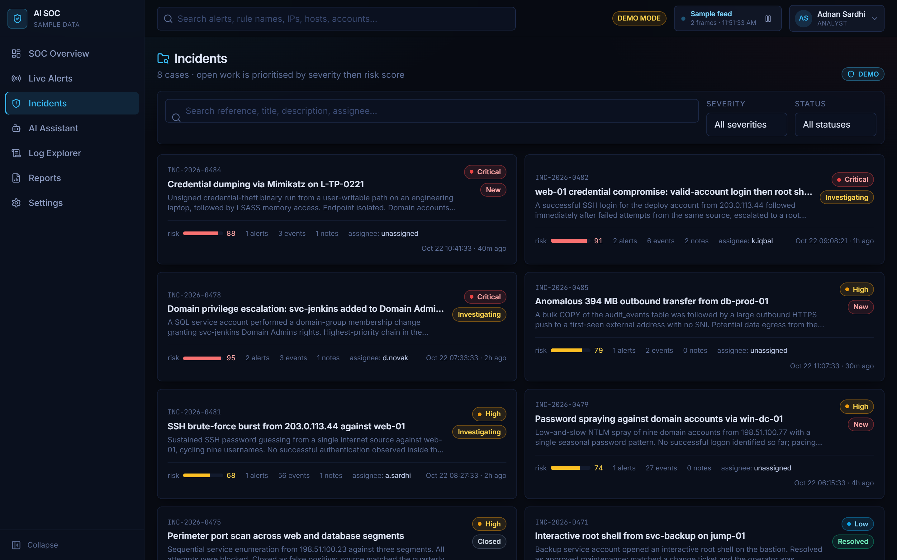
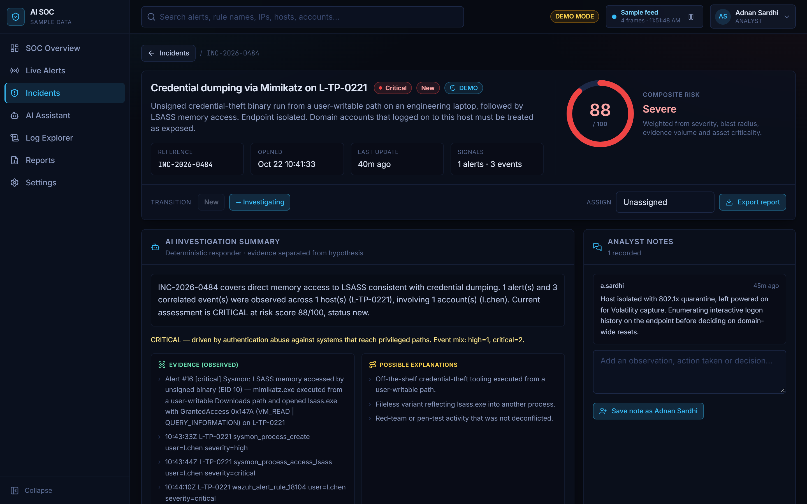
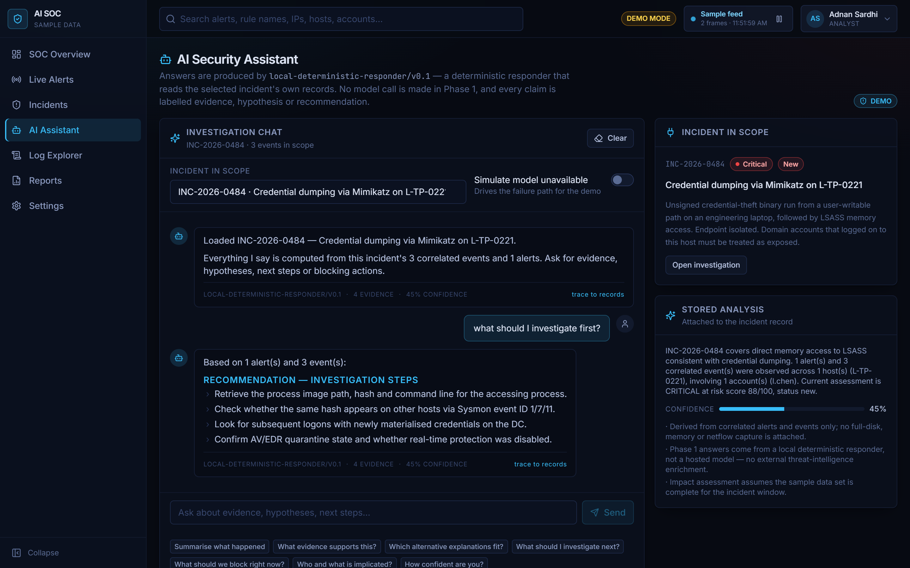
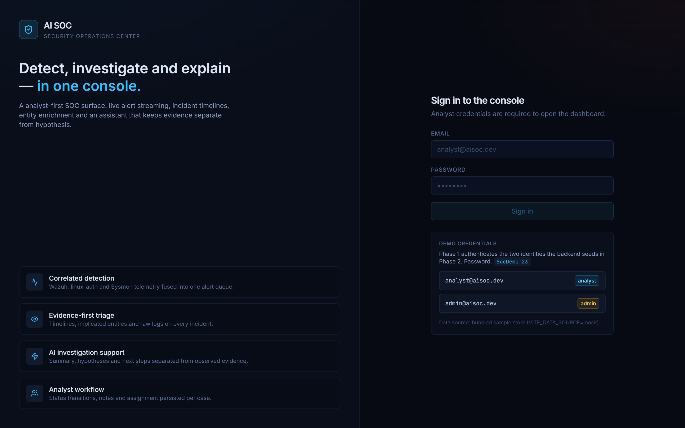
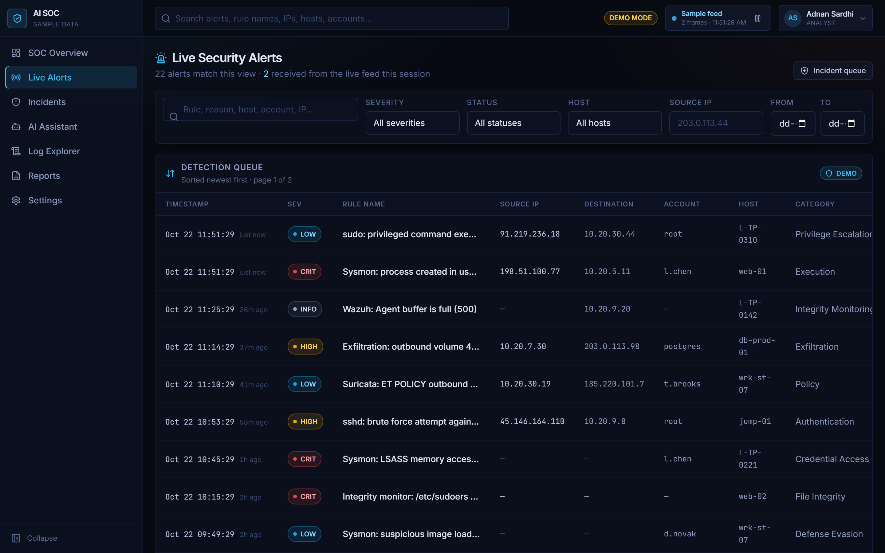
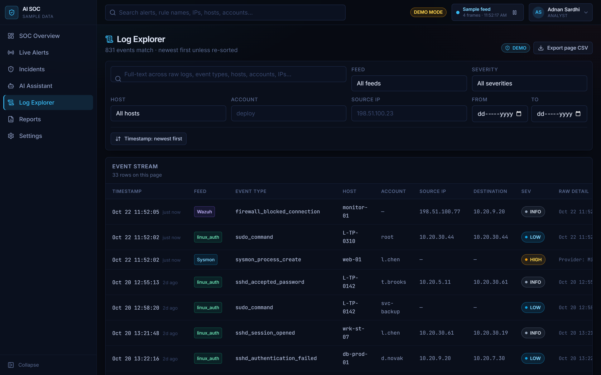
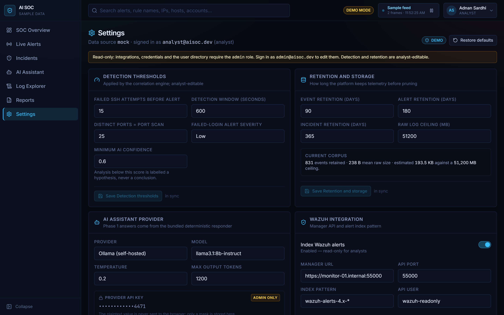

<div align="center">


# AI-Powered Security Operations Center

**A SOC console that ingests security telemetry, detects suspicious activity with
deterministic rules, correlates alerts into incidents, scores risk on a scale you
can take apart, and helps an analyst investigate.**

[](https://github.com/sadhik-ali/AI-Security-Operations-Center-SOC/actions/workflows/ci.yml)
[](LICENSE)
[](CHANGELOG.md)
[](backend/requirements.txt)
[](frontend/package.json)
[](backend/tests)
[](#repository-layout)

*Every output is an indicator that requires an analyst. Nothing here blocks an IP,
disables an account, isolates a host, or executes a command — least of all one
suggested by a model.*

</div>

---

## Table of contents

- [Why this project](#why-this-project)
- [Interface tour](#interface-tour)
- [What is built](#what-is-built)
- [Tech stack](#tech-stack)
- [Architecture](#architecture)
- [Quick start](#quick-start)
- [Detection rules](#detection-rules)
- [Risk scoring](#risk-scoring)
- [Data model](#data-model)
- [API surface](#api-surface)
- [Security posture](#security-posture)
- [Testing](#testing)
- [Documentation](#documentation)
- [Repository layout](#repository-layout)
- [Roadmap](#roadmap)
- [Contributing](#contributing)

---

## Why this project

Security operations tools fail analysts in two predictable ways. Either the alerts
are so noisy that real signals drown, or the interesting ones arrive as an
unexplained number — "risk: 78, trust us" — that nobody can defend to a stakeholder
and nobody can tune.

This console is built around the opposite commitments:

| Commitment | How it is enforced |
| --- | --- |
| **Explainable by construction** | every alert carries `reason`, `evidence` and a per-factor `score_breakdown`; weights live in configuration and a test asserts they sum to 100 |
| **Indicators, never verdicts** | wording, UI and docs treat a match as suspicious activity requiring investigation; no rule claims to prove intent |
| **AI that cannot act** | no code path from model output to a shell, firewall, account or host isolation; AI notes persist with `ai_generated = true` |
| **Telemetry is untrusted input** | log content is never evaluated, never interpolated into a command or query, and never an instruction to the model |
| **Degradation you can see** | optional services render as "unavailable" with a reason; the mock store announces itself as synthetic in the top bar |
| **No fake functionality** | an unimplemented phase is a documented gap, not a button that pretends to work |

The result is a system whose claims survive inspection — which is the property a
SOC tool most needs and least often has.

---

## Interface tour

All eight screens, rendered from the bundled synthetic corpus with no backend
running.

| Screen | Preview |
| --- | --- |
| **SOC Overview** — fleet KPIs, events-and-alerts trend, severity distribution, top external sources, most-affected hosts |  |
| **Incident Investigation** — correlated cases with risk bars, alert/event counts, assignees and status |  |
| **Investigation detail** — evidence separated from hypothesis, decomposable risk gauge, status transitions, analyst notes |  |
| **AI Assistant** — grounded answers over the incident's own events, labelled as a deterministic responder |  |

<details>
<summary>The remaining screens</summary>

| Screen | What it shows |
| --- | --- |
| **Login** | split brand panel and sign-in form with the demo identities surfaced |
| **Live Alerts** | detection queue with severity, rule, source IP, account, host, category and filter bar |
| **Log Explorer** | 831 events searchable by feed, severity, host, account, IP, time range and sort order |
| **Reports** | posture summaries plus per-incident investigation reports, exported as CSV or JSON from the live store |
| **Settings** | detection thresholds, scoring bands, retention, AI provider, integration toggles |






</details>

---

## What is built

| Phase | Scope | State |
| --- | --- | --- |
| **1** | React UI, dark SOC theme, eight pages on a realistic synthetic world | ✅ **complete** |
| **2** | FastAPI, JWT auth + RBAC, nine SQLAlchemy models, Alembic migration, 37 tests | ✅ **complete** |
| **3** | Wire the UI to the backend; dashboard, event, alert and incident APIs | ⬜ next |
| **4** | Ingestion, normalisation, nine detection rules, scoring, correlation, live WebSocket alerts | ⬜ planned |
| **5** | Incident workflow, timelines, retention, report export | ⬜ planned |
| **6** | Ollama assistant with deterministic fallback | ⬜ planned |
| **7** | Wazuh + OpenSearch adapters | ⬜ [designed](wazuh/README.md) |
| **8** | Docker Compose, hardening, documentation | 🟨 compose + CI + docs done |

Phase 1 and Phase 2 run independently today: the UI works fully against its bundled
sample store, and the API works fully against SQLite with no infrastructure at all.

<details>
<summary><b>Phase 1 delivered</b> — ~9,200 lines of TypeScript across 41 files</summary>

- Nine routes: Login, SOC Overview, Live Alerts, Incidents, Investigation detail,
  AI Assistant, Log Explorer, Reports, Settings.
- One internally consistent synthetic corpus (hosts, accounts, events, alerts,
  incidents that reference each other correctly) from a seeded RNG, so a demo is
  reproducible.
- Recharts trend with 12 h / 24 h / 48 h / 3 d ranges, severity donut, top-source
  and most-affected-hosts panels.
- `Panel`, `RiskGauge`, `Drawer`, badge, control and loading/empty/error state
  components; activity feed; global search; collapsible sidebar and mobile nav.
- Live feed abstraction with automatic polling fallback — a dropped socket degrades
  to refresh instead of going silently stale.
- `VITE_DATA_SOURCE=mock|api` behind a service layer whose types mirror the backend
  schemas, so Phase 3 changes transport rather than pages.
- Reports page assembling eight real sections per incident — overview, timeline,
  evidence, severity and risk, rules triggered, AI summary, remediation, analyst
  notes — and exporting them as CSV or JSON.
- AI Assistant implemented as an honest deterministic responder, visibly labelled.

</details>

<details>
<summary><b>Phase 2 delivered</b> — ~3,000 lines of Python across 36 files</summary>

- FastAPI app that creates and seeds a SQLite database on first boot: two analysts
  and 16 configuration rows.
- Nine models with composite indexes shaped to the queries the UI runs, plus
  Alembic `0001_initial_schema` and `alembic check` in CI to prove no drift.
- bcrypt cost 12 with an explicit 72-byte ceiling; HS256 JWTs carrying
  `sub/role/tz/sg/iat/exp/jti/use`.
- **Server-side logout without a shared denylist**: a per-user `session_group` in
  every token, rotated on logout, so revocation holds across workers.
- Byte-identical `401` bodies and comparable timing for wrong-password vs
  unknown-account (a dummy bcrypt comparison absorbs the missing lookup).
- RBAC via route dependencies with self-demotion, self-disable and last-active-admin
  lockout guards.
- Sliding-window rate limits per IP **and** per account; request-size cap enforced
  before the body is read; CORS allowlist; security headers.
- JSON request logging with request ids, deliberately skipping `/api/auth/login`;
  audit trail on its own session so it survives a rolled-back request; secret
  scrubbing; validation errors that name fields but never values.
- `WS /ws/alerts` with token authentication, 8 KiB frame cap, stale-socket pruning.
- Startup guards that refuse `ENVIRONMENT=prod` with a placeholder secret or with
  TLS verification disabled.
- 37 tests over auth, RBAC, limits, tokens, banding, enum persistence, the full FK
  graph, and duplicate-ingest protection.

</details>

---

## Tech stack

| Layer | Technology | Version |
| --- | --- | --- |
| UI | React, TypeScript, Vite | 18.3 · 5.7 · 6.0 |
| Styling | Tailwind CSS with a custom `soc-*` palette | 3.4 |
| Charts / icons | Recharts, Lucide React | 2.15 · 0.469 |
| Routing / HTTP | react-router-dom v6, Axios | 6.28 · 1.7 |
| API | FastAPI, Uvicorn, Pydantic v2 | 0.115 · 0.34 · 2.10 |
| ORM / migrations | SQLAlchemy 2.0 typed, Alembic | 2.0.36 · 1.14 |
| Auth | PyJWT HS256, bcrypt | 2.10 · 4.2 |
| Storage | SQLite (dev) · PostgreSQL 16 (compose) | — |
| Search | OpenSearch 2.11.1 (optional, `search` profile) | — |
| Reasoning | Ollama `llama3.1:8b-instruct` (optional, `ai` profile) | — |
| Testing | Pytest (37 tests) · Vitest (Phase 8) | 8.3 |
| Delivery | Docker Compose, multi-stage nginx, GitHub Actions | — |

Every dependency is pinned exactly, so a build is reproducible and an upgrade is a
visible decision rather than a drift.

---

## Architecture

```
Browser  (React 18 + Vite + TypeScript + Tailwind + Recharts)
   │  Axios REST  +  WebSocket /ws/alerts (polling fallback)
   ▼
FastAPI ─────────────────────────────  JWT auth, RBAC, rate limiting,
   │                                   request-size cap, audit trail
   ├── detection/     nine deterministic rules      (Phase 4)
   ├── correlation/   keys + windows → incidents    (Phase 4)
   ├── scoring/       transparent weighted 0–100    (Phase 4)
   ├── ai_assistant/  Ollama, advisory only         (Phase 6)
   ├── collectors/    Wazuh / auth.log / Sysmon     (Phase 4, 7)
   └── integrations/  OpenSearch client             (Phase 7)
   ▼
SQLAlchemy 2 → SQLite (local dev) | PostgreSQL (Docker / production)
                                 → OpenSearch (event search, integrated mode)
```

**Two modes, one code path.** `MODE=demo` uses the synthetic generator and
SQL-backed search; `MODE=integrated` accepts Wazuh alerts and searches OpenSearch.
Detection never asks where an event came from — it reads normalised rows — so a rule
proven on generated traffic behaves identically on real traffic.

Optional services are probeable, not assumed: `/api/system/capabilities` reports
what is configured, and anything unavailable renders as a visible "unavailable"
state while the rest of the application keeps working.

Full detail, including the request lifecycle, the AI boundary and the
decision-by-decision trade-offs: **[docs/ARCHITECTURE.md](docs/ARCHITECTURE.md)**.

---

## Quick start

### The UI, with no backend

```bash
cd frontend
npm install
npm run dev            # http://localhost:5173
```

### The API, with no database server

```bash
cd backend
python -m venv .venv
.venv/Scripts/python.exe -m pip install -r requirements.txt   # .venv/bin/ on Linux
cp ../.env.example .env
echo "SECRET_KEY=$(python -c 'import secrets;print(secrets.token_hex(32))')" >> .env
.venv/Scripts/python.exe -m uvicorn app.main:app --reload --port 8000
```

First start creates `ai_soc.db`, applies the schema and seeds two analysts.
Interactive API docs at <http://localhost:8000/docs>.

| Identity | Password | Role |
| --- | --- | --- |
| `analyst@aisoc.dev` | `SocDemo!23` | analyst — dashboard, alerts, incidents, logs |
| `admin@aisoc.dev` | `SocDemo!23` | admin — plus user management and settings |

Demo accounts for a demo database, and never created under `ENVIRONMENT=prod`.

### The whole stack

```bash
cp .env.example .env      # set SECRET_KEY and POSTGRES_PASSWORD
docker compose --profile search --profile ai up --build
docker compose exec ollama ollama pull llama3.1:8b-instruct
```

| Service | URL |
| --- | --- |
| UI | <http://localhost:5173> |
| API + docs | <http://localhost:8000/docs> |
| PostgreSQL | `localhost:5432` |
| OpenSearch | `localhost:9200` (`search` profile) |
| Ollama | `localhost:11434` (`ai` profile) |

> **Certificate trouble on install?** This machine runs Avast HTTPS inspection,
> which re-signs TLS; Node and pip use their own CA bundles and reject it. Trust the
> intercepting root additionally rather than disabling verification — the exact
> commands are in [docs/DEVELOPMENT.md](docs/DEVELOPMENT.md#tls-interception-avast-and-similar).

Setup, configuration, migrations, debugging and CI gates:
**[docs/DEVELOPMENT.md](docs/DEVELOPMENT.md)** ·
deployment shapes and the production checklist:
**[docs/DEPLOYMENT.md](docs/DEPLOYMENT.md)**

---

## Detection rules

Nine rules, all thresholds read from `application_settings` so retuning is a form
field rather than a redeploy. Each alert carries rule ID, name, description,
matching evidence, timestamp, the IPs / users / hosts involved, severity, score
contribution, and recommended investigation steps.

| # | Rule | Default trigger | Severity |
| --- | --- | --- | --- |
| R1 | SSH brute force | 5 failures from one source in 300 s | high |
| R2 | Password spraying | 4 distinct accounts from one source in 600 s | high |
| R3 | Successful login after failures | success after 3+ failures in 600 s | critical |
| R4 | Unusual login | outside a 14-day baseline, ≥5 baseline events required | medium → high |
| R5 | Port scan indicators | 12 distinct ports from one source in 120 s | medium |
| R6 | Privilege escalation | admin-group / privilege change reported by the source | critical |
| R7 | Suspicious process activity | 5 configurable indicators (mimikatz, LSASS access, …) | high |
| R8 | Repeated rule triggers | 3 related alerts on one entity in 900 s | high |
| R9 | Configurable custom rules | rules as data: `detection_rules` + settings | per rule |

`unusual_login` stays **silent** without enough history rather than inventing an
anomaly, and the UI says "insufficient baseline data". That restraint is the point:
a dashboard that guesses is worse than one that admits it does not know.

Full specifications, false-positive posture and investigation guidance:
**[docs/DETECTION_RULES.md](docs/DETECTION_RULES.md)** *(engine lands in Phase 4;
the parameters are live configuration today)*.

---

## Risk scoring

A 0–100 weighted sum, never a model's opinion, with the per-factor numbers
persisted so the gauge can be taken apart.

| Factor | Weight | Measures |
| --- | --- | --- |
| Severity of the strongest signal | 35 | highest rule severity in the group |
| Success after failure | 18 | did the attempt turn into access |
| Event volume | 15 | how much telemetry backs it |
| Frequency | 12 | how tightly events cluster in time |
| Breadth | 12 | distinct hosts / accounts / ports touched |
| Recency | 8 | how close the activity is to now |

| Score | Band | | Score | Band |
| --- | --- |---|---| --- |
| 0 – 24 | informational | | 50 – 74 | high |
| 25 – 49 | low | | 75 – 100 | critical |

Bands are configuration (`scoring.bands`), and a test asserts the weights still sum
to exactly 100 — so retuning cannot silently produce a scale that maxes out at 83.

"The score is 78 because severity contributed 31 of 35 and success-after-failure 18
of 18" is a claim you can check. "The model says high risk" is not.

---

## Data model

Nine tables, all timestamps UTC-aware and converted to the viewer's timezone in the
UI.

| Table | Role |
| --- | --- |
| `users` | analysts and admins, bcrypt hashes, per-user timezone, `session_group` for logout |
| `security_events` | normalised telemetry with `raw` + `normalized` JSON, unique `ingest_key` |
| `alerts` | one rule match: reason, evidence, score breakdown, status |
| `detection_rules` | configurable parameters, severity, score contribution, investigation steps |
| `incidents` | correlated group with unique `correlation_key`, score, status, assignee |
| `incident_events` | which events fed an incident, *why*, and what each contributed |
| `incident_notes` | analyst notes; `ai_generated` flagged so machine text cannot pose as human findings |
| `audit_logs` | every authentication, authorisation and configuration change |
| `application_settings` | JSON config seeded with detection and scoring defaults |

An incident is never an unexplained aggregate: `incident_events.reason` and
`contributed_score` record why each event belongs and what it added to the number.

Schema, constraints and the `EnumString` decision:
**[docs/DATA_MODEL.md](docs/DATA_MODEL.md)**

---

## API surface

| Method | Path | Auth | | Method | Path | Auth |
| --- | --- | --- |---|---| --- | --- |
| `POST` | `/api/auth/login` | — | | `PATCH` | `/api/users/{id}/role` | admin |
| `GET` | `/api/auth/me` | bearer | | `PATCH` | `/api/users/{id}/active` | admin |
| `POST` | `/api/auth/logout` | bearer | | `GET` | `/api/health` | — |
| `GET` | `/api/users` | admin | | `GET` | `/api/system/capabilities` | bearer |
| `POST` | `/api/users` | admin | | `WS` | `/ws/alerts?token=` | JWT |

```bash
TOKEN=$(curl -s -X POST http://localhost:8000/api/auth/login \
  -H 'Content-Type: application/json' \
  -d '{"email":"analyst@aisoc.dev","password":"SocDemo!23"}' | jq -r .access_token)

curl -s http://localhost:8000/api/auth/me -H "Authorization: Bearer $TOKEN"
# {"id":2,"email":"analyst@aisoc.dev","full_name":"Demo Analyst","role":"analyst",
#  "is_active":true,"preferred_timezone":"UTC","last_login_at":"2026-10-22T10:48:24.233123Z"}

curl -s "http://localhost:8000/api/users?page=1&limit=50" -H "Authorization: Bearer $TOKEN"
# 403 {"detail":"Insufficient role for this operation."}   <- analysts are not admins

curl -s -X POST http://localhost:8000/api/auth/logout -H "Authorization: Bearer $TOKEN"
curl -s http://localhost:8000/api/auth/me -H "Authorization: Bearer $TOKEN"
# 401 {"detail":"Session has been signed out."}
```

Responses are snake_case throughout. Errors are
`{"detail": "...", "request_id": "..."}`; validation failures add a field-level
`errors` array that never echoes the submitted value.

Complete reference plus the Phase 3–6 endpoint contracts:
**[docs/API.md](docs/API.md)**

---

## Security posture

**Implemented and tested now:** bcrypt cost 12 with a 72-byte input ceiling ·
HS256 JWTs with expiry and a `use` claim · role-based route guards · logout that
invalidates every previously issued token for that user · per-IP **and**
per-account login rate limits · a request-size ceiling enforced before the body is
read · CORS allowlist with `allow_credentials=False` · parameterised ORM access only
· audit logging that survives a rolled-back request · validation errors that redact
submitted secrets · security headers · an OpenSearch mapping that cannot be
exhausted by hostile payload fields · a startup guard that refuses
`ENVIRONMENT=prod` with the placeholder secret or with TLS verification disabled.

**Deliberate limits, stated rather than discovered:** the rate limiter and WebSocket
registry are per-process, so one uvicorn worker is the supported shape —
multi-worker needs gateway limiting and Redis fan-out (Phase 8). A token carries its
role until it expires, mitigated by session-group rotation and short expiry. No MFA
yet. Retention pruning is configuration without a job.

**Boundaries that will not move:** no automated response, no command execution from
AI output, no telemetry treated as an instruction, no verdicts about intent, no
plaintext credentials, no disabled TLS verification.

Full guarantees, refusals and known gaps: **[SECURITY.md](SECURITY.md)**

---

## Testing

```bash
cd backend  && .venv/Scripts/python.exe -m pytest    # 37 passed
cd backend  && .venv/Scripts/alembic.exe check       # No new upgrade operations detected.
cd frontend && npm run typecheck                     # tsc --noEmit
cd frontend && npm run build                         # production bundle
```

| Area | What the tests protect |
| --- | --- |
| Authentication | login shape, case-insensitive email, byte-identical 401s, tampered / expired / foreign-key-signed tokens, logout invalidation |
| Authorization | analyst blocked from admin routes, role change kills the session, self-lockout and last-admin guards |
| Rate limiting | per-account 429 with `Retry-After`, plus a direct limiter unit test |
| Passwords | bcrypt salt uniqueness, verification, 73-byte input rejected |
| Domain | severity bands at 24.99 / 25 / 49.9 / 50 / 74.9 / 75 / 100, configurable thresholds, `closed` has no outgoing transition |
| Schema | nine tables present, `EnumString` round-trip, seeded weights summing to 100, secret rows storing no value |
| Integrity | full incident → alert → event → link → note graph, duplicate `correlation_key` and `ingest_key` rejected |
| Audit | login/logout/rejection rows written, `_scrub()` redaction |

CI runs all of this on Python 3.11 and 3.13, and Node 20 and 22, plus
`docker compose config`: **[.github/workflows/ci.yml](.github/workflows/ci.yml)**

---

## Documentation

| Document | About |
| --- | --- |
| [ARCHITECTURE.md](docs/ARCHITECTURE.md) | layers, request lifecycle, live channel, AI boundary, decision trade-offs, threat model |
| [API.md](docs/API.md) | every implemented endpoint with real responses, plus the planned contracts |
| [DATA_MODEL.md](docs/DATA_MODEL.md) | nine tables, an ERD, constraints, enum persistence, migration policy |
| [DETECTION_RULES.md](docs/DETECTION_RULES.md) | the nine rules, thresholds, evidence, false-positive posture |
| [DEVELOPMENT.md](docs/DEVELOPMENT.md) | setup, configuration, migrations, testing, debugging, TLS interception |
| [DEPLOYMENT.md](docs/DEPLOYMENT.md) | four shapes, OpenSearch and Ollama, production checklist, scaling |
| [ROADMAP.md](docs/ROADMAP.md) | eight phases with acceptance criteria, and what is out of scope by design |
| [DEMO.md](docs/DEMO.md) | a ten-minute walkthrough, a nine-step verification checklist, likely questions |
| [PROJECT_REPORT.md](docs/PROJECT_REPORT.md) | chapter-by-chapter final-year report scaffold with word budgets and evidence pointers |
| [SECURITY.md](SECURITY.md) | reporting, guarantees, deliberate refusals, known gaps |
| [CONTRIBUTING.md](CONTRIBUTING.md) | ground rules, workflow, style, testing expectations |
| [CHANGELOG.md](CHANGELOG.md) | release notes for 0.1.0 and what is coming |
| [wazuh/README.md](wazuh/README.md) | collector design and trust boundary (Phase 7) |

---

## Repository layout

```
ai-soc/
├─ backend/
│  ├─ app/
│  │  ├─ api/routes/      auth · users · system · ws
│  │  ├─ auth/            bearer decode, RBAC guards, session-group check
│  │  ├─ core/            config · security · ratelimit · logging · middleware
│  │  ├─ database/        base · session · types (EnumString) · init_db
│  │  ├─ models/          enums · the nine SQLAlchemy models
│  │  ├─ schemas/         Pydantic request/response contracts
│  │  └─ services/        audit writer · WebSocket broadcaster
│  ├─ alembic/            env.py · versions/0001_initial_schema.py
│  ├─ tests/              conftest · test_auth · test_domain
│  └─ requirements.txt · Dockerfile
├─ frontend/
│  └─ src/
│     ├─ pages/           9 route components
│     ├─ components/      layout · ui · charts · ActivityFeed
│     ├─ services/        api · auth · ws · mockStore · aiLocal
│     ├─ context/         AuthContext · LiveContext
│     ├─ data/            world · fixtures · logs   (synthetic corpus)
│     ├─ hooks/ lib/      useAsync · format · rng
│     └─ types/           api.ts — mirrors the backend contract
├─ docs/                  architecture · API · rules · model · guides
│  └─ assets/             hero animation + 8 interface screenshots
├─ sample_logs/           linux_auth.log · sysmon_events.ndjson · wazuh_alerts.ndjson
├─ opensearch/            index-template.json   (dynamic: strict, raw unindexed)
├─ wazuh/                 integration design + trust boundary
├─ .github/               CI workflow · issue + PR templates · dependabot
└─ docker-compose.yml · .env.example · SECURITY.md · CONTRIBUTING.md · CHANGELOG.md · LICENSE
```

`sample_logs/` holds synthetic telemetry in the three formats the Phase 4 parsers
will accept, using RFC 5737 documentation ranges (`203.0.113.x`, `198.51.100.x`) so
no real address appears anywhere. It is demo input, not evidence from a network.

---

## Roadmap

Next is **Phase 3** — the UI stops inventing its own data: dashboard, event, alert
and incident endpoints, filters bound to query parameters, and
`VITE_DATA_SOURCE=api` as the default. Then **Phase 4**, the detection engine whose
contract is already written.

Beyond the brief, tracked but deliberately unscheduled: response playbooks with
approval gates, per-tenant RBAC, learned baselines, Sigma rule import, case
management, alert-suppression windows with expiry.

Full phase-by-phase acceptance criteria: **[docs/ROADMAP.md](docs/ROADMAP.md)**

---

## Contributing

Read [CONTRIBUTING.md](CONTRIBUTING.md) first — this project has explicit rules
about placeholders, verdicts and the AI boundary. Then get a stack running in five
minutes with [docs/DEVELOPMENT.md](docs/DEVELOPMENT.md), and open an issue before
anything larger than a typo.

Found something exploitable? Use [SECURITY.md](SECURITY.md); please do not open a
public issue.

Want to see it work? [docs/DEMO.md](docs/DEMO.md) is a ten-minute walkthrough with a
verification checklist.

<a href="docs/assets/screenshots/05-investigation.png"></a>

---

## License

[MIT](LICENSE) © 2026 AI Security Operations Center (AI SOC) contributors.

Built as a final-year project and cybersecurity portfolio piece. All telemetry,
hosts, accounts, incidents and personnel names in this repository are synthetic.
