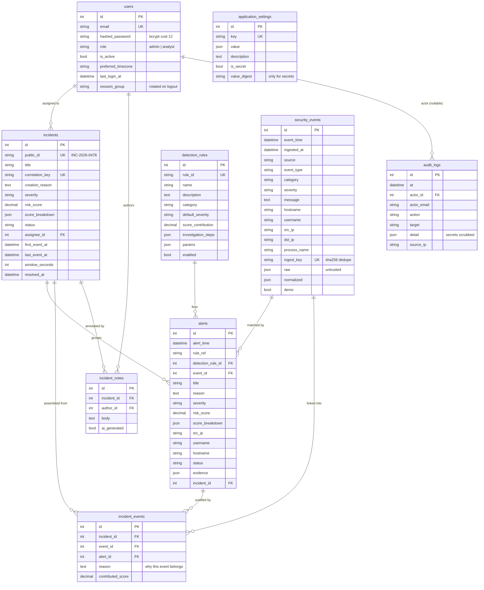

# Data model

Nine tables, defined once in SQLAlchemy 2.0 typed style
([`backend/app/models/models.py`](../backend/app/models/models.py)) and mirrored
by Alembic revision `0001_initial_schema`. `alembic check` runs in CI so the two
can never drift apart silently.

All timestamps are `DateTime(timezone=True)` and stored **UTC**. Conversion to the
viewer's `preferred_timezone` happens in the UI, never in the database — a stored
local time is ambiguous across daylight-saving boundaries.

---

## Entity relationships

The diagram is GitHub-rendered; view it on the repository page rather than in a
plain text editor.

---

## Table-by-table

### `users`
Analysts and admins. `hashed_password` is bcrypt at cost 12 and is never
serialised — `UserOut` omits it, along with `session_group`. `is_active` gates
authentication without deleting history. `preferred_timezone` is an IANA name
validated against `zoneinfo` at write time.

**`session_group` is the interesting column.** It is an opaque per-user id baked
into every JWT as `sg`. Logout rotates it, so every previously issued token for
that user stops validating — server-side revocation across workers without a
per-token denylist that has to be shared or persisted.

### `security_events`
Normalised telemetry from any source: Wazuh, Linux auth logs, Sysmon, or the
synthetic generator. `source`, `category` and `severity` are enums; `event_type`
is a free string so a new feed does not require a migration.

`raw` holds the original payload exactly as received. It is **untrusted content**:
rendered as data, never evaluated, never interpolated into a query or command, and
never treated as an instruction by the AI assistant. `normalized` holds the
parser's structured view, so a mapping change can be audited against the original.

`ingest_key` is a unique sha256 over the dedupe key. A collector that retries
after a partial failure cannot double-count an event; the second insert conflicts
and the collector treats it as success.

Two composite indexes match the queries the UI actually runs:
`ix_events_time_src (event_time, source)` for time-range filtering by feed, and
`ix_events_host_time (hostname, event_time)` for "what happened on this host".

### `detection_rules`
Rule definitions as data: ID, name, description, category, default severity,
score contribution, investigation steps as a JSON array, and a `params` blob.
`enabled` turns a rule off without deleting the alerts it already produced.
See [DETECTION_RULES.md](DETECTION_RULES.md).

### `alerts`
One rule matching one event. Carries `reason` (plain-language why it fired),
`evidence` (the events/fields that justify it), `risk_score`, and
`score_breakdown` (per-factor contribution, so the gauge can be taken apart).

`UniqueConstraint(rule_ref, event_id)` makes re-evaluation idempotent: running the
engine over an overlapping window produces no duplicates.

Status is a one-way-ish workflow: `new → acknowledged → investigating`, plus
`false_positive` and `resolved`. `false_positive` is a first-class outcome, not a
deletion — a suppressed rule needs to stay countable.

### `incidents`
Correlated alerts. `public_id` (`INC-2026-0478`) is what humans cite;
`correlation_key` is **unique**, which is what makes grouping deterministic and
re-runnable. `creation_reason` records why these events were considered related.
`first_event_at` / `last_event_at` bound the timeline; `window_seconds` is the
correlation window in force when it was built, so a later retuning does not
rewrite history.

Status transitions are declared in code, not folklore:

| From | Allowed to |
| --- | --- |
| `new` | `investigating`, `closed` |
| `investigating` | `resolved`, `closed` |
| `resolved` | `investigating` (reopened), `closed` |
| `closed` | — terminal |

A test asserts `closed` has no outgoing edge.

### `incident_events`
The junction that keeps correlation honest. It records which event fed which
incident, `reason` (why it belongs), and `contributed_score` (what it added).
Without this, an incident is an unexplained aggregate. Cascade-deleted with the
incident; unique on `(incident_id, event_id)`.

### `incident_notes`
Analyst findings. `ai_generated` is a boolean on the row, so machine text can
never be presented as a human conclusion — and it survives export, which is where
the distinction actually matters.

### `audit_logs`
Every authentication, authorisation and configuration change: actor (id *and*
email, so the record outlives the account), action, target, JSON detail, source
IP. Written on its **own database session** so an audit entry for a failed
request still exists after that request's transaction is rolled back.

`detail` passes through `_scrub()`, which replaces any value under a
secret-shaped key with `"***redacted***"`.

### `application_settings`
JSON configuration keyed by name, seeded with 16 rows covering detection
thresholds, scoring weights and bands, the correlation window, retention, the AI
provider, and integration toggles.

`is_secret` marks rows whose value lives only in an environment variable. Such a
row stores **no value** — at most `value_digest`, a non-reversible hash that lets
the UI say "configured" without being able to read it back.

---

## Enum persistence: `EnumString`

SQLAlchemy's `sa.Enum` stores the enum **name** (`ADMIN`, `CRITICAL`), which makes
`WHERE role = 'admin'` return nothing. A bare `String` column does the opposite:
Python gets a plain string, so `user.role is Role.ADMIN` is silently `False` and
RBAC fails open.

`EnumString` is a `TypeDecorator` over `String` that binds `.value` on write and
rehydrates the enum member on read. SQL is readable, Python is typed, and both
agree. A round-trip test pins the behaviour.

---

## Migration policy

- Fresh clone on SQLite: `create_all` at startup, so the app runs with one command.
- Anything else: Alembic is the only path. `docker compose` runs
  `alembic upgrade head` before serving.
- `alembic check` in CI proves models and migration agree on every push.
- SQLite revisions render inside `batch_alter_table`, because SQLite cannot
  `ALTER COLUMN` — the same migration works on both engines.

## Retention

`retention.days` seeds `events: 90`, `alerts: 180`, `incidents: 365`. The
pruning job is Phase 5; the values are configuration today so the policy exists
before the mechanism does.
